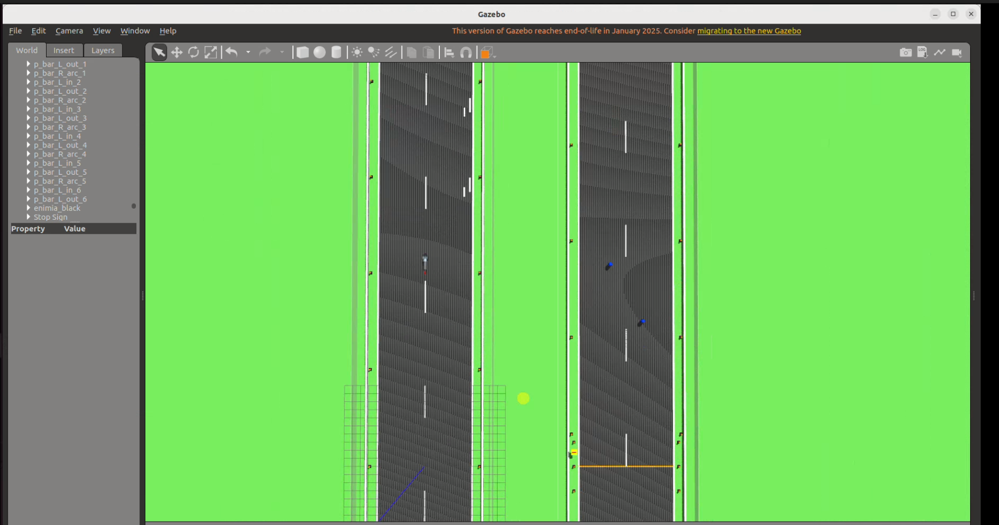
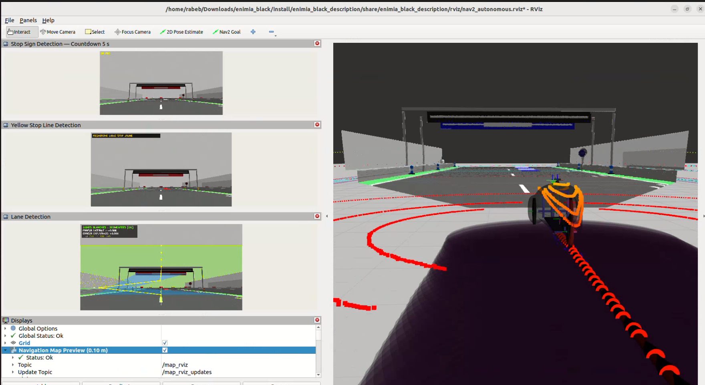
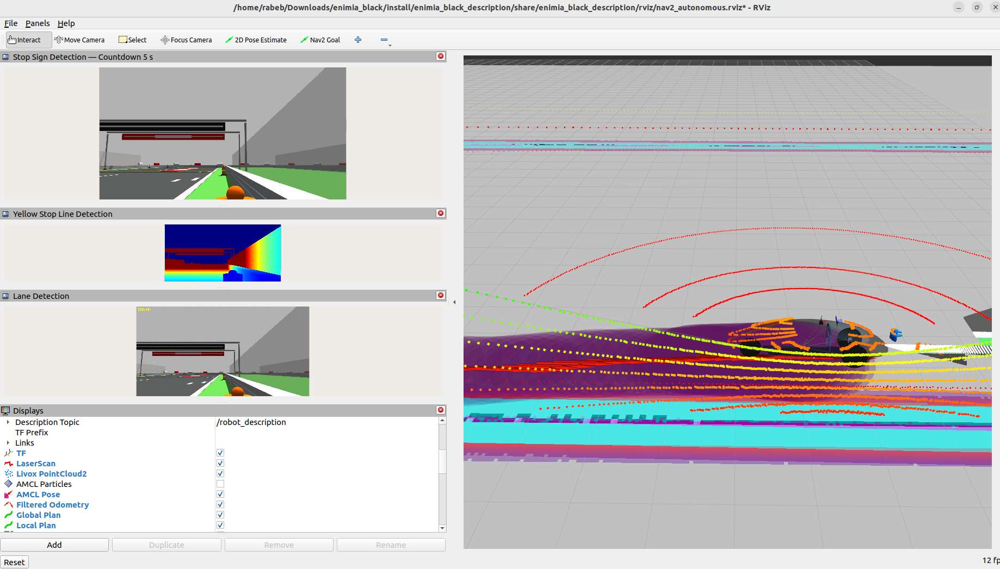
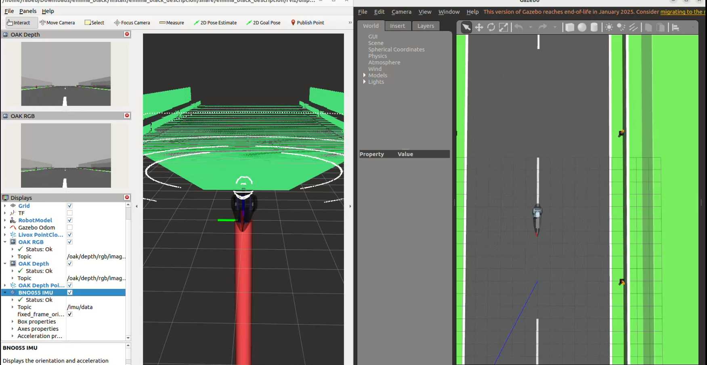

# Enimia Black - Autonomous Prototype for Shell Eco-marathon

## Overview

Enimia Black is an autonomous vehicle prototype designed for the Shell Eco-marathon Europe and Africa competition. This project implements advanced autonomous driving capabilities using ROS2 (Robot Operating System 2) with a focus on energy efficiency and precise navigation.

## Project Description

### Competition Context
The Shell Eco-marathon is a global competition that challenges student teams to design, build, and test energy-efficient vehicles. Enimia Black participates in the autonomous category, where the vehicle must navigate a predefined track without human intervention while maximizing energy efficiency.

### Key Features

- **Autonomous Navigation**: Complete autonomous driving system using ROS2 Navigation Stack (Nav2)
- **Lane Detection**: Ultra-fast lane detection using deep learning models
- **Path Planning**: Cubic spline interpolation for smooth trajectory generation
- **Sensor Fusion**: Integration of multiple sensors including OAK-D camera
- **Gazebo Simulation**: Full simulation environment for testing and development
- **Reinforcement Learning**: RL-based driving policy optimization
- **Energy Optimization**: Focus on minimal energy consumption during autonomous operation

## Hardware Components

- **OAK-D Camera**: Depth AI camera for visual perception
- **Lidar**: 2D/3D lidar for obstacle detection and mapping
- **IMU**: Inertial Measurement Unit for orientation and motion tracking
- **Motor Controllers**: Precision motor control for steering and propulsion
- **Battery Management**: Energy monitoring and optimization system

## Software Architecture

### Perception System

The perception system is responsible for understanding the vehicle's environment through sensor data processing and computer vision.



#### Lane Detection
- **Ultra-Fast Lane Detection**: Deep learning model for real-time lane detection
- **CNN-based approach**: Uses convolutional neural networks for robust lane detection
- **Multi-lane tracking**: Simultaneous detection of multiple lane markings
- **Camera-based**: Utilizes OAK-D camera for visual input



#### Object Detection
- **Obstacle detection**: Identifies static and dynamic obstacles
- **Distance estimation**: Calculates distance to detected objects
- **Classification**: Categorizes objects (vehicles, pedestrians, barriers)

### Navigation System

The navigation system enables autonomous path planning and execution using ROS2 Navigation Stack.



#### SLAM (Simultaneous Localization and Mapping)
- **Mapping**: Creates 2D occupancy grid maps of the environment
- **Localization**: Estimates vehicle pose within the map
- **Loop closure**: Detects when vehicle returns to previously visited locations
- **Graph optimization**: Improves map accuracy over time

#### AMCL (Adaptive Monte Carlo Localization)
- **Particle filter**: Uses probabilistic approach for localization
- **Pose estimation**: Provides accurate position and orientation
- **Global localization**: Can recover from kidnapping scenarios
- **Map matching**: Correlates sensor data with map features

#### Nav2 Navigation Stack
- **Global planner**: Computes optimal path from start to goal
- **Local planner**: Generates velocity commands for short-term navigation
- **Behavior tree**: Manages navigation behaviors and recovery strategies
- **Costmap layers**: Handles static and dynamic obstacles



### Path Planning

The path planning module generates smooth and efficient trajectories for the vehicle.

#### Waypoints Generation
- **Cubic Spline Interpolation**: Creates smooth curves between waypoints
- **Trajectory optimization**: Minimizes curvature and acceleration
- **Velocity planning**: Generates velocity profiles along the path
- **Collision checking**: Ensures planned path is obstacle-free

#### Trajectory Following
- **Pure pursuit**: Geometric path following algorithm
- **PID control**: Maintains desired trajectory
- **Lateral control**: Steering angle computation
- **Longitudinal control**: Speed regulation

### Sensors Integration

The system integrates multiple sensors for robust perception and localization.

#### OAK-D Camera
- **Stereo vision**: Provides depth information
- **AI acceleration**: On-device neural network inference
- **High resolution**: 4K image capture
- **Low latency**: Real-time processing

#### Lidar
- **2D/3D scanning**: Provides point cloud data
- **Range measurement**: Accurate distance measurements
- **Obstacle detection**: Identifies objects in the environment
- **Mapping support**: Contributes to SLAM

#### IMU (Inertial Measurement Unit)
- **Orientation**: Provides roll, pitch, yaw angles
- **Angular velocity**: Measures rotational speed
- **Linear acceleration**: Detects acceleration changes
- **Sensor fusion**: Combined with odometry for state estimation

### Code Structure

#### ROS2 Packages

1. **enimia_black_description**
   - URDF models of the vehicle
   - Gazebo world and plugin configurations
   - Launch files for simulation and navigation
   - Robot state publisher configuration

2. **enimia_rl**
   - Reinforcement learning environment (Gym-compatible)
   - Data collection scripts
   - Training pipelines for RL models
   - Vision-based RL implementation
   - Offline training capabilities

3. **oak_d_camera**
   - OAK-D camera driver
   - Image processing pipelines
   - Depth estimation
   - Camera calibration
   - URDF models for camera mounting

4. **waypoints_calculations**
   - Cubic spline implementation
   - Waypoint generation algorithms
   - Trajectory smoothing
   - Path optimization

5. **waypoints_niagara_creator**
   - Interactive waypoint creation
   - Waypoint visualization
   - Export/import functionality

6. **waypoints_niagara_loader**
   - Waypoint loading from files
   - Path reconstruction
   - Trajectory publishing

7. **lane_assist_ros**
   - Lane detection node
   - Lane tracking algorithm
   - Visual feedback
   - Control signal generation

8. **lane_follower**
   - Lane following control
   - Steering angle computation
   - Speed control
   - Safety monitoring

### Launch Files

#### Simulation Launches

```bash
# Gazebo with autonomous navigation
ros2 launch enimia_black_description gazebo_nav2_autonomous.launch.py
```
- Launches Gazebo simulation
- Spawns the vehicle model
- Starts Nav2 navigation stack
- Loads map and configures planners

```bash
# SLAM for mapping
ros2 launch enimia_black_description slam.launch.py
```
- Launches Gazebo with SLAM
- Starts slam_toolbox for mapping
- Enables real-time map building
- Saves map on command

#### Real Vehicle Launches

```bash
# Camera driver
ros2 launch oak_d_camera camera.launch.py
```
- Initializes OAK-D camera
- Publishes camera images
- Provides depth information
- Configures image processing

```bash
# Lane detection
ros2 launch lane_assist_ros lane_detection.launch.py
```
- Starts lane detection node
- Processes camera images
- Publishes lane information
- Visualizes detected lanes

```bash
# Autonomous navigation
ros2 launch enimia_black_description autonomous_navigation.launch.py
```
- Launches full navigation stack
- Integrates perception modules
- Executes path planning
- Controls vehicle actuators

## Installation

### Prerequisites
- Ubuntu 22.04 LTS
- ROS2 Humble
- Python 3.10+
- CUDA-capable GPU (for deep learning models)

### Build Instructions

```bash
# Clone the repository
git clone https://github.com/your-username/enimia_black.git
cd enimia_black

# Install dependencies
rosdep install --from-paths src --ignore-src -r -y

# Build the workspace
colcon build

# Source the workspace
source install/setup.bash
```

## Usage

### Simulation

```bash
# Launch Gazebo simulation with autonomous navigation
ros2 launch enimia_black_description gazebo_nav2_autonomous.launch.py

# Launch SLAM for mapping
ros2 launch enimia_black_description slam.launch.py

# Launch navigation with existing map
ros2 launch enimia_black_description navigation.launch.py map:=/path/to/map.yaml
```

### Real Vehicle

```bash
# Launch camera driver
ros2 launch oak_d_camera camera.launch.py

# Launch lane detection
ros2 launch lane_assist_ros lane_detection.launch.py

# Launch autonomous navigation
ros2 launch enimia_black_description autonomous_navigation.launch.py
```

## Training

### Reinforcement Learning

```bash
# Train RL model
cd src/enimia_rl
python enimia_rl/train.py

# Train vision model
python enimia_rl/train_vision.py
```

### Lane Detection

```bash
# Train lane detection model
cd Ultra-Fast-Lane-Detection-master
python train.py
```

## Configuration

### Maps
Maps are stored in the `maps/` directory. To create a new map:

```bash
ros2 run slam_toolbox async_slam_toolbox_node
ros2 run nav2_map_server map_saver_cli -f maps/my_map
```

### Waypoints
Waypoints can be generated using the waypoints creator:

```bash
ros2 launch waypoints_niagara_creator waypoints.launch.py
```

## Team

This project is developed by the Enimia team for the Shell Eco-marathon competition.

## License

This project is licensed under the MIT License - see LICENSE file for details.

## Acknowledgments

- Shell Eco-marathon organization
- ROS2 community
- Open-source autonomous driving projects
